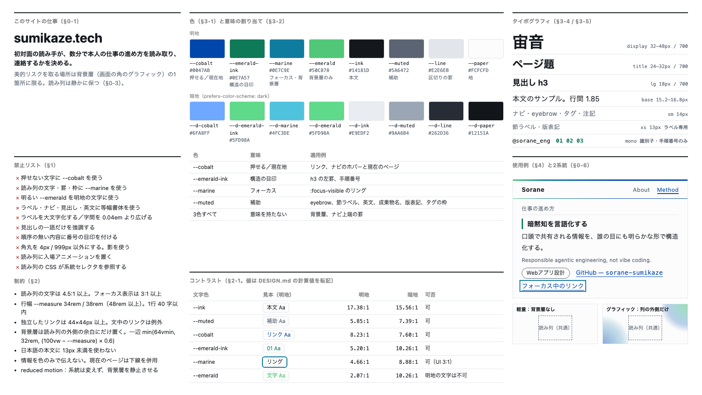

# DESIGN.md — sumikaze.tech

version: v0.1
updated: 2026-09-25

本ドキュメントは sumikaze.tech のビジュアルデザイン体系を定義する。
人間も AI も本ドキュメントを読む。**全てのページはここに定義されたトークンのみで構成する。**

トークンに存在しない値（生の hex、任意の px / rem 値）を CSS に直接書かない。
必要な値が無い場合は、実装を進める前に本ドキュメントへの追加を提案する。

トークンの実体は各 HTML の `<style>` 冒頭（「1. トークン」節）にある。
2ファイルのトークン節は同一に保つ（README の方針により、CSS の共通化はファイルが3枚目に達した時点で再検討する）。

---

## 0. 前提

### 0-1. このサイトの仕事

**初対面の読み手が、数分で本人の仕事の進め方を読み取り、連絡するかを決める。** 全ての視覚的判断はこれを基準に評価する。

装飾の是非は「見栄えが良いか」ではなく「読み取りと、連絡の判断を妨げないか」で判定する。

### 0-2. 受け手

- 仕事の依頼・協業を検討している初対面の相手。スマートフォンから来ることを前提にする
- 頻度は1回きりに近い。再訪を前提にした学習コスト（独自の操作・独自の記号）を置かない
- 本サイトは本人の技術的な実験場を兼ねる。ただし実験場であることは**手段**であり、仕事（§0-1）ではない。実験は §0-3 の背景層と、§0-6 の系統の切替で行う

### 0-3. 美的リスクを取る場所

AI にデザインを任せる際の一般的な指示（Anthropic 公式の Claude Code プラグイン frontend-design 等）は、「独自の観点に対価を払う顧客」を前提に、美的リスクを取れと求める。
本サイトにおける判定：**部分的に成り立つ**（個人サイトであり、見た目自体が名刺の一部として読まれる）。

- **美的リスクを取る場所は、背景層（画面の角に固定したグラフィック）の1箇所に限る。**
- 読み列（本文の列。ナビ・見出し・本文・リンク・フッター）は静かに保つ。読み列で目を引く工夫をしない

### 0-4. 入口

実装後。現物：`index.html` / `method.html`（コミット `cd744eb` 時点）。
描画はヘッドレス Chrome で、明地・暗地 × 幅 375 / 768 / 1024 / 1440px を確認した。

### 0-5. 継承するもの・しないもの

- 継承する：ブランド3色（cobalt / marine / emerald）とその暗地の値、無彩色4値、余白スケール `--s1`〜`--s6`、行幅 `--measure`、明地・暗地の両対応、`color-scheme: light dark` の宣言
- 継承しない：等幅書体・大文字化・字間の広げによるラベルの装飾、読み列での3色の併用（§1-4）

### 0-6. 2系統（軽量／グラフィック）

将来、次の2系統を切り替えられるようにする。**両系統は本ドキュメントの同じ判断基準から派生する。**

| 系統 | 背景層 | 読み列 |
|---|---|---|
| 軽量 | **描かない。** 装飾の SVG・装飾のための JS・装飾のための追加リクエストが 0 | 共通 |
| グラフィック | 描く。§2-6 の範囲内で表現を広げてよい | 共通 |

- **2系統の差は背景層だけである。** 読み列の CSS は系統を表すセレクタを参照しない
- 内容（テキスト）は1か所に置き、HTML は1つのまま CSS / JS で出し分ける
- 動き（§3-8）と重さ（系統）は別の軸として扱う。`prefers-reduced-motion` は系統を切り替えない
- 系統の既定値・切替の UI・軽量系統の数値予算は未決（§7-1）

---

## 1. 禁止リスト

**実装前に必ず読む。** 迷った場合、ここに抵触していないかを最初に確認する。

### 1-1. 色

- 読み列の有彩色は `--cobalt`（押せる）と `--emerald-ink`（構造の目印）の2役のみ。押せない文字に `--cobalt` を使わない
- `--marine` はフォーカスリングと背景層のみ。読み列の文字・罫・枠に使わない
- 明るい `--emerald`（#50C878）を明地の文字に使わない（2.07:1。§2-1）
- 変化をつけるための第4の差し色を足さない

### 1-2. 書体・装飾

- 等幅書体（`--font-mono`）は識別子（ハンドル・ドメイン）と手順番号にのみ使う。ラベル・ナビ・見出し・英文に使わない
- ラベルを `text-transform: uppercase` にしない。字間を 0.04em より広げない
- 見出しの一語だけを色・斜体・太字で強調しない
- 番号の目印（01 / 02 …）は内容が順序を持つ場合にのみ使う（現状は method.html の4段のみ）
- 角丸は `--radius-sm` / `--radius-pill` の2値のみ。影を使わない

### 1-3. 動き

- 読み列に入場アニメーション（フェード・スライドイン）を置かない
- 動きは背景層に限り、かつグラフィック系統に限る

### 1-4. 診断の記録

§0-1 の1文から導けなかった選択と、その由来・判定。

| 選択 | 由来 | 判定 |
|---|---|---|
| ブランド3色（cobalt / marine / emerald） | 既存実装で「ブランド3色」として定義済み | 正当。残す。ただし読み列での役割を2つに絞る |
| `--cobalt` をリンクと、押せない英文（`.en`）・成果物名（`.artifact`）の両方に使う | 意味の割り当てを持たないまま部品を作った結果 | 意味の二重化。押せない側を `--muted` へ |
| `--marine` を eyebrow・タグ・注記の罫・フォーカスリングに使う | 同上 | 読み列からはフォーカスリング以外を外す |
| 等幅＋大文字化＋字間 0.14〜0.18em のラベル（ナビ・eyebrow・節ラベル）、等幅の小さなデータ風ラベル（タグ・リンク・版表記・英文）、`A — B` 形式のラベル | AI 生成のデザインに頻出する既定値（主題を問わず現れる「テンプレートの定型装飾」） | 1つずつなら正当でも、揃うと既定値に見える。**最も安い1本（等幅の用途）を折る**。大文字化と字間は等幅と一緒に外れる。`A — B` の文言は §7-2 へ引き渡す |
| 手順番号 01〜04 | method.html の4段は順序を持つ | 正当。残す |
| 右上・左下の背景グラフィック | 本人の選択（§0-3 のリスクを取る場所） | 正当。ただし読み列に重なっていた（§6） |

---

## 2. 制約（計算で決まる値）

**本節の値は好みではなく計算で決まる。例外を作らない。** 根拠は WCAG 2.2 と、経験則は区分を併記する。
達成できない場合は、実装を止めて相談する。

### 2-1. コントラスト

比は WCAG 2.2 の相対輝度の式で計算した（推定値を書かない）。地は `--paper`。

| 組み合わせ | 明地 | 暗地 | 用途 | 可否 |
|---|---|---|---|---|
| `--ink` | 17.38:1 | 15.56:1 | 本文 | 可 |
| `--muted` | 5.85:1 | 7.39:1 | 補助テキスト | 可 |
| `--cobalt` | 8.23:1 | 7.60:1 | リンク | 可 |
| `--emerald-ink` | 5.20:1 | 10.26:1 | 手順番号・見出しの罫 | 可 |
| `--marine` | 4.66:1 | 8.88:1 | フォーカスリング（UI 部品 3:1 以上） | 可 |
| `--emerald` | 2.07:1 | 10.26:1 | 背景層のみ | **明地の文字は不可** |
| `--line` | 1.22:1 | 1.32:1 | 区切りの罫（情報を持たない） | 文字・必須の境界には不可 |

補助面（`--tag-bg`。`.principle` の地）の上：暗地で `--ink` 13.73:1、`--muted` 6.53:1。

基準：本文 4.5:1 以上、大きいテキスト（24px 以上、または約 18.7px 以上の太字）3:1 以上、UI 部品・フォーカス表示 3:1 以上。

### 2-2. 幅と行長

```css
--measure: 34rem;  /* 48rem 未満 */
--measure: 38rem;  /* 48rem 以上 */
```

- `.wrap` の最大幅は `--measure`（左右の内側余白 `--s3` を含む）。本文は 1行 40 字以内（規格 AAA）に収まる。実測で約 33 字
- 余った幅を要素の間に分配しない。末尾の余白として捨てる

### 2-3. タップ標的

**独立したリンク（ナビ・リンクのリスト）は 44×44px 以上（AAA）。** 採用理由：初対面の読み手はスマートフォンから来る。
文中のリンクは規格の例外（文中のリンク）に頼る。

```css
--tap: 44px;
```

### 2-4. 数値の表示

縦に並ぶ数値の箇所は無い（該当なし）。手順番号は等幅書体で桁が揃う。

### 2-5. アクセシビリティの達成基準

- §2-1 のコントラストを満たす
- 全ての操作可能要素にキーボードフォーカスが当たり、`:focus-visible`（`--marine` 2px、offset 3px）が可視である
- 情報を色のみで伝えない。現在のページはナビで色に加えて下線（2px）で示す
- 装飾の SVG は `aria-hidden="true"` と `focusable="false"` を持つ
- 見出しレベルを飛ばさない

### 2-6. 背景層と読み列

**背景層が最も濃く重なった地の上でも、読み列の文字は §2-1 の比を満たす。** 系統を問わない。

- 明地で `--muted` と `--emerald-ink` が 4.5:1 を保てる背景層の不透明度は、最も濃い箇所で 0.09 以下（計算値）。これでは背景層として成り立たないため、**背景層は読み列の外側の余白にだけ置く**
- 実装：背景層の一辺は `min(64vmin, 32rem, (100vw − --measure) × 0.6)`。列の外側に余白が無い幅では 0 になり、描かれない
- 検証：文字を透明にして描画し、読み列の範囲で最も濃い（暗地では最も明るい）画素に対して比を計算する。幅 375 / 768 / 1024 / 1440px × 明地・暗地で確認する

### 2-7. 文字の大きさ（経験則）

- 日本語の本文に 13px 未満を使わない。`--text-xs`（13px）はラベル専用
- 行間は本文 1.85

---

## 3. トークン（選択）

### 3-1. 色

```css
:root {
  color-scheme: light dark;

  /* ブランド3色 */
  --cobalt:      #0047AB;  /* 押せる */
  --marine:      #0E7C9E;  /* フォーカスリング・背景層 */
  --emerald:     #50C878;  /* 背景層のみ */
  --emerald-ink: #0E7A57;  /* 構造の目印（見出しの罫・手順番号） */

  /* 無彩色 */
  --paper: #FCFCFD;  /* 地 */
  --ink:   #14181D;  /* 本文 */
  --muted: #5A6472;  /* 補助テキスト・ラベル・タグの枠・注記の罫 */
  --line:  #E2E6EB;  /* 区切りの罫 */

  /* 面 */
  --nav-bg: rgba(252, 252, 253, 0.94);
  --tag-bg: rgba(255, 255, 255, 0.6);  /* タグ・原則の枠の地 */

  --blend: multiply;  /* 背景層の合成 */
}

@media (prefers-color-scheme: dark) {
  :root {
    --cobalt:      #6FA8FF;
    --marine:      #4FC3DE;
    --emerald:     #5FD98A;
    --emerald-ink: #5FD98A;

    --paper: #12151A;
    --ink:   #E9EDF2;
    --muted: #9AA6B4;
    --line:  #262D36;

    --nav-bg: rgba(18, 21, 26, 0.94);
    --tag-bg: rgba(255, 255, 255, 0.05);

    --blend: screen;
  }
}
```

背景層の SVG マスクが使う `#FFFFFF` / `#000000` は色ではなく輝度マスクの値であり、トークンの対象外とする。

### 3-2. 色の意味の割り当て

| 色 | 意味 | 適用例 |
|---|---|---|
| `--cobalt` | 押せる／現在地 | リンク、ナビのホバーと現在のページ |
| `--emerald-ink` | 構造の目印 | h3 の左罫、手順番号 |
| `--marine` | フォーカス | `:focus-visible` のリング |
| `--ink` | 情報 | 本文、見出し、タグの文字 |
| `--muted` | 補助 | eyebrow、節ラベル、英文の一文、成果物名、版表記、注記、タグの枠、注記の罫 |
| 3色すべて | （意味を持たない） | 背景層、ナビ上端の罫のグラデーション |

**1つの色に2つの意味を持たせない。**

### 3-3. 状態の表現

| 状態 | 表現 | 色 |
|---|---|---|
| 現在のページ（ナビ） | 下線 2px ＋ 文字色 | `--cobalt` |
| ホバー（ナビ） | 文字色 | `--cobalt` |
| フォーカス | リング 2px | `--marine` |

### 3-4. 書体

```css
--font-sans: system-ui, -apple-system, "Hiragino Kaku Gothic ProN",
             "Noto Sans JP", "Yu Gothic", sans-serif;
--font-mono: ui-monospace, SFMono-Regular, Menlo, Consolas, monospace;
```

- `--font-sans`：全ての文字の既定
- `--font-mono`：識別子（`.id`。`@sorane_eng`・`sorane-sumikaze`・`sumikaze.tech`）と手順番号のみ。識別子はリンク文の中で `<span class="id">` で囲む

### 3-5. サイズ・行間・字間

```css
--text-xs:      0.8125rem;  /* 13px。節ラベル・成果物名・版表記 */
--text-sm:      0.875rem;   /* 14px。ナビ・eyebrow・タグ・英文・注記・リンクのリスト */
--text-base:    clamp(0.95rem, 0.9rem + 0.25vw, 1.05rem);  /* 本文 */
--text-lg:      1.125rem;   /* 18px。h3 */
--text-title:   clamp(1.5rem, 1.2rem + 1.4vw, 2rem);       /* ページ題（method） */
--text-display: clamp(2rem, 1.5rem + 2.4vw, 3rem);         /* 名前（index） */
```

- 行間：本文 1.85。見出しは 1.25（display）/ 1.45（title）/ 1.6（h3）
- 字間は3値のみ：見出し 0.01em、本文 0.02em、ラベル 0.04em

### 3-6. 間隔

```css
--s0: 0.25rem;
--s1: 0.5rem;
--s2: 1rem;
--s3: 1.5rem;
--s4: 2.5rem;
--s5: 4rem;
--s6: 6rem;
```

トークンに無い間隔を使わない。文字に対する相対値（下線の offset `0.25em`、ローマ字の `0.5em`）は例外とする。

### 3-7. 面・角丸・影

| 階層 | トークン | 用途 |
|---|---|---|
| 基準面 | `--paper` | 本体 |
| 補助面 | `--tag-bg` | タグ、原則の枠 |
| ナビ | `--nav-bg` | 固定ナビ（背景層を 94% 覆う） |

```css
--radius-sm:   4px;    /* 原則の枠 */
--radius-pill: 999px;  /* タグ */
```

影は使わない。

### 3-8. モーション

- 動きを置けるのは背景層のみ、かつグラフィック系統のみ（§0-6 / §1-3）。現状は背景層の減光（`opacity` 600ms ease-out）のみ
- 利用者の操作に応える動き（開く・閉じる等）は、読み列に置く場合も変化を示す目的に限る。現状は該当なし
- **`prefers-reduced-motion: reduce` のとき**：系統は変えない。背景層は静止画として残し、`transition` / `animation` / `scroll-behavior: smooth` を止める。減光は即時に切り替わる

---

## 4. コンポーネント規則

### 4-1. ナビ

- ブランド名（`Sorane`）：`--font-sans` 700、`--text-base`、字間 0.04em、`--ink`
- リンク：`--text-sm` 500、`--muted`。押せる領域は `--tap` × `--tap` 以上。現在のページは `--cobalt` ＋下線 2px
- 上端の罫 3px は3色のグラデーション（ブランドの表示。意味を持たない）

### 4-2. 見出し

- eyebrow（職種・ページ種別）：`--text-sm` 500、`--muted`、大文字化しない
- 節ラベル（h2）：`--text-xs` 500、`--muted`、下罫 1px `--line`
- h3：`--text-lg` 700。`.trait` / `.detail` は左罫 3px `--emerald-ink`

### 4-3. タグ

`--text-sm`、文字 `--ink`、枠 1px `--muted`、角丸 `--radius-pill`、地 `--tag-bg`。押せないため `--cobalt` を使わない。

### 4-4. 手順（method.html）

番号列 `--s4`、番号は `--font-mono` 700 `--text-sm` `--emerald-ink`。成果物名は `--text-xs` `--muted`。

### 4-5. 注記・原則の枠

- 注記：左罫 3px `--muted`、`--text-sm`、`--muted`（強調部は `--ink`）
- 原則の枠：枠 1px `--line`、角丸 `--radius-sm`、地 `--tag-bg`。主文は 700、補足・英文は `--text-sm` `--muted`

### 4-6. リンクのリスト

`--text-sm`。各リンクの押せる領域の高さは `--tap` 以上（`min-height` と、`1lh` を使った上下余白）。識別子は `.id`。

---

## 5. 画面レイアウト

### 5-1. 共通構造

- 固定ナビ（高さ `--nav-h` = 4rem = 64px）→ ヘッダ → 節 → フッター。全て `.wrap`（`--measure`）の1列、左揃え
- `scroll-padding-top` は `--nav-h`。ナビの高さを変えたら `--nav-h` を同時に直す
- 背景層は `position: fixed` で画面の角に置き、`z-index: -1`。§2-6 の大きさの上限に従う
- index.html：右上・左下の2枚。「仕事の進め方」以降は不透明度 0.1 に減光する
- method.html：右上の1枚のみ、不透明度 0.35

---

## 6. 監査

監査日：2026-09-25。対象：コミット `cd744eb` の `index.html` / `method.html`（行番号は同コミット時点）。
重大度：P0 制約違反・使用不能／P1 トークン違反／P2 一貫性の揺れ。根拠：コードで確定／描画で確認／推定。

- [P0｜描画で確認] index.html:126-133 背景層：幅 375 / 768 / 1024px で読み列に重なり、最も濃い地の上で `--ink` 2.55:1、`--muted` 1.16:1 → §2-6 違反 → **修正済み**
- [P0｜描画で確認] method.html:104-111 背景層：幅 375 / 768 / 1024px で読み列に重なり、明地の `--muted` 3.72:1、`--emerald-ink` 3.31:1 → §2-6 違反 → **修正済み**
- [P0｜描画で確認] index.html:211-222 / method.html:173-184 ナビのリンク：高さ 31.3px（描画で実測） → §2-3 違反 → **修正済み**
- [P0｜描画で確認] index.html:337-343 / method.html:368-374 リンクのリスト：押せる領域の高さ 16px（描画で実測） → §2-3 違反 → **修正済み**
- [P0｜コードで確定] index.html:345-351 / method.html:376-382 版表記：0.7rem（11.2px） → §2-7 違反 → **修正済み**（`--text-xs`）
- [P1｜コードで確定] index.html:316-322 `.trait .en`、method.html:293-301 `.artifact`、method.html:328-335 `.principle .en`：押せない文字に `--cobalt` → §3-2 違反 → **修正済み**（`--muted`）
- [P1｜コードで確定] index.html:234-242 / method.html:196-204 eyebrow、index.html:286-295 タグ、method.html:234 注記の罫：読み列で `--marine` → §3-2 違反 → **修正済み**
- [P1｜コードで確定] ナビ・ブランド名・eyebrow・ローマ字・節ラベル・タグ・英文・リンク・成果物名・版表記に `--font-mono` → §3-4 違反 → **修正済み**（識別子は `.id` へ）
- [P2｜コードで確定] ナビ・eyebrow・節ラベルの大文字化と字間 0.14〜0.18em → §3-5 → **修正済み**
- [P2｜描画で確認] `--nav-h: 3.5rem`（56px）に対し、実際のナビは 69.2px（描画で実測） → アンカー移動で見出しが約 13px 隠れる → §5-1 → **修正済み**（ナビを 64px に揃え `--nav-h: 4rem`）
- [P2｜コードで確定] 文字サイズがトークンを持たず 10 種の rem 値に散っていた（0.75 / 0.78 / 0.8 / 0.85 / 0.9 / 0.92 / 0.95 / 1.02 / 1.05 / 1.1rem）→ §3-5 → **修正済み**（6値に集約。h3 は 18px に統一）
- [P2｜コードで確定] トークンに無い間隔（0.9rem / 0.75rem / 0.6rem / 0.35rem / 0.15rem / 2.1rem / 0.35em 0.9em）→ §3-6 → **修正済み**（`--s0`〜`--s4` へ）

修正後の確認（2026-09-25、1回）：§2-6 の検証を幅 4種 × 明地・暗地 × 2ページで実施し、違反 0 件。明地・暗地・375px の描画で崩れが無いことを確認した。ナビは 64px、独立したリンクは全て高さ 44px 以上（描画で実測）。

---

## 7. 未解決事項

### 7-1. 未決の軸

- 2系統の既定値（初回訪問時にどちらを出すか） — 未決
- 系統の切替の UI（置き場所・表記・記憶の方法） — 未決
- 軽量系統の数値予算（転送量・リクエスト数） — 未決。現状の定義は「背景層ゼロ」のみ
- グラフィック系統で、列の外側に余白が無い幅（スマートフォン）に背景層をどう出すか — 未決。現状は描かない（§2-6）。出す場合も §2-6 の制約は変わらない
- 3ページ目以降のトークンの共通化（外部 CSS 化） — README の方針に従い、3枚目の時点で再検討

### 7-2. 文言リスト

文言は本ドキュメントでは監修しない。現在の文言を記録して引き渡す。

| 画面・箇所 | 現在の文言 |
|---|---|
| ナビ（共通） | Sorane ／ About ／ Method |
| index：eyebrow | Web Engineer |
| index：名前 | 宙音 ／ Sorane |
| index：節ラベル | 対応可能領域 ／ 仕事の進め方 ／ 連絡先 |
| index：英文 | Responsible agentic engineering, not vibe coding. |
| index：連絡先 | メールで連絡する ／ X — @sorane_eng ／ GitHub — sorane-sumikaze |
| index：版表記 | Version 1.1 — Last update: 2026-08-22 |
| method：eyebrow | Methodology |
| method：ページ題 | AI前提の開発プロセス — 設計の形式 |
| method：節ラベル | この資料について ／ 実装までの4段 ／ 前提として置いている設計 ／ 実例の出典 ／ 連絡先 |
| method：成果物名 | → 要件定義書（版管理） ／ → 発注元への確認事項リスト ／ → タスク仕様書 ／ → 要件⇔実装 対応表 |
| method：出典・連絡先 | sumikaze.tech — 本サイト ／ GitHub — sorane-sumikaze ／ メールで連絡する ／ X — @sorane_eng ／ トップページへ戻る |
| method：版表記 | Methodology digest v1.0 — Last update: 2026-08-21 |

`A — B` 形式のラベルと、成果物名の先頭の `→` は、§1-4 の診断で既定値の要素として挙がった。残すかどうかは文言の判断として扱う。

---

## 8. 実装チェックリスト

ページを1つ追加・変更するたびに確認する。**各項目は対応する節を持つ。**

- [ ] 生の hex 値・トークンに無い rem / px 値を書いていない（§3）
- [ ] 禁止リストに抵触していない（§1）
- [ ] 文字色の組み合わせが §2-1 の「可」だけである（§2-1）
- [ ] `.wrap` の最大幅が `--measure` である（§2-2）
- [ ] 独立したリンクの押せる領域が 44×44px 以上（§2-3）
- [ ] `:focus-visible` が可視である（§2-5）
- [ ] 情報を色のみで伝えていない（§2-5 / §3-3）
- [ ] 背景層が読み列に重ならない。§2-6 の検証を幅 4種 × 明地・暗地で通した（§2-6）
- [ ] 読み列の CSS が系統を表すセレクタを参照していない（§0-6）
- [ ] 色を意味の割り当てどおりに使っている。押せない文字に `--cobalt` が無い（§3-2）
- [ ] `--font-mono` が識別子と手順番号以外に使われていない（§3-4）
- [ ] 文字サイズが `--text-*` の6値、字間が3値のいずれかである（§3-5）
- [ ] 2ファイルのトークン節が同一である（冒頭）
- [ ] `prefers-reduced-motion: reduce` で transition / animation / smooth scroll が止まる（§3-8）
- [ ] ナビの高さを変えた場合、`--nav-h` を同時に直した（§5-1）
- [ ] 新規の文言を文言リストに登録した（§7-2）

フォーム部品は無いため `accent-color` の項目は置かない。

---

## 9. デザインボード



生成元：`docs/frontend-design/board.html`。**正本は本ドキュメントであり、ボードは射影である。**
食い違った場合は本ドキュメントが正しい。ボードを直接編集せず、本ドキュメントを直してから撮り直す。

---

## 10. 更新履歴

| バージョン | 日付 | 内容 |
|---|---|---|
| v0.1 | 2026-09-25 | 初版。既存の index.html / method.html を現物として策定し、監査結果を同時に修正した |
